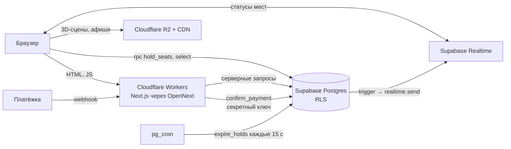

# Архитектура

Своего бэкенд-сервера нет. Сайт — Next.js на Cloudflare Workers, всё состояние — в Supabase.

## Части

| Часть | Где | Отвечает за |
|---|---|---|
| Страницы | `src/app/` | Каталог, событие, корзина. Серверные компоненты по умолчанию |
| 3D-зал | `src/components/venue/VenueViewer.tsx` | Обзор зала и вид с места, Three.js |
| Логика площадки | `src/lib/venue/` | Формат, генерация мест, высота пола. Без three.js и React |
| Бронь | SQL-функции в `supabase/migrations/` | Атомарная смена статусов мест |
| Доступ к данным | `src/lib/supabase/` | Клиенты для браузера и сервера |
| Фоновые задачи | pg_cron, позже Edge Functions + pgmq | Снятие броней, письма, PDF |

## Потоки данных

**Выбор мест.** Площадка (`venue_layouts.params`) и места (`seats`) почти не меняются — кешируются. Статусы (`event_seats.status`) отдаются отдельно: сначала снимок, потом изменения через Realtime. Сцена не пересобирается — перекрашиваются инстансы.

**Покупка.** Подробно — [booking.md](booking.md). Коротко: `hold_seats` → оплата → webhook → `confirm_payment` → билеты.

**Почему так:** [decisions/0001-stack.md](decisions/0001-stack.md), [0003-booking-in-postgres.md](decisions/0003-booking-in-postgres.md).

## Как страница события получает места

1. Сервер (`src/lib/events.ts`) отдаёт событие, `params` площадки и ценовые зоны — небольшой JSON.
2. Браузер строит места из `params` через `generateSeats` — тысячи координат по сети не передаются.
3. Браузер вызывает `rpc("event_seat_map")`: id, статус и зона каждого места по одному символу, в порядке `seat_id`. Порядок совпадает с `generateSeats`, потому что `scripts/load-demo.mts` вставляет места именно так и проверяет это.
4. `applySeatMap` накладывает статусы и зоны на места; если число не совпало — ошибка, а не неверная схема.

Страницы рендерятся на каждый запрос (`connection()` в `src/lib/events.ts`), чтобы сборка не требовала доступа к базе.
